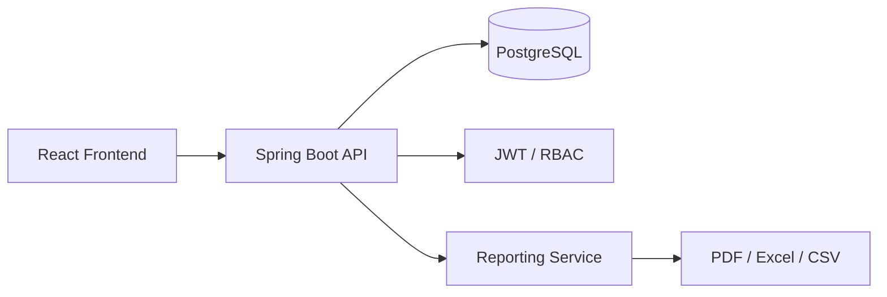

# Architecture

## System overview

## Module layout

- auth
- organization
- patient
- invoice
- payment
- insurance
- claim
- report
- audit
- notification
- approval

## Principles

- Domain-driven modular monolith
- DTO-based API exposure
- Backend validation and financial calculations
- Flyway for schema evolution
- PostgreSQL for transactional operations
