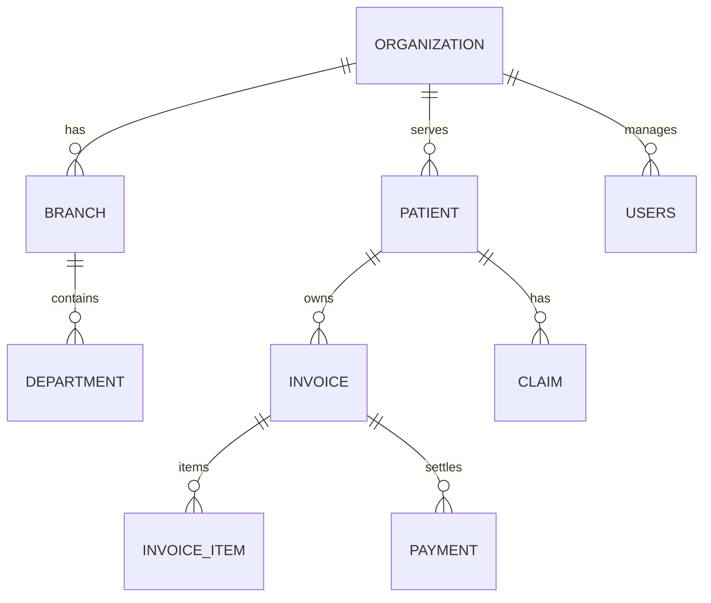

# Database design

## Core entities

## Key constraints

- UUID primary keys
- Foreign keys for organization isolation
- Unique invoice numbers and MRNs
- Check constraints for financial validity
- Indexes for invoice number, patient, due dates, status fields
